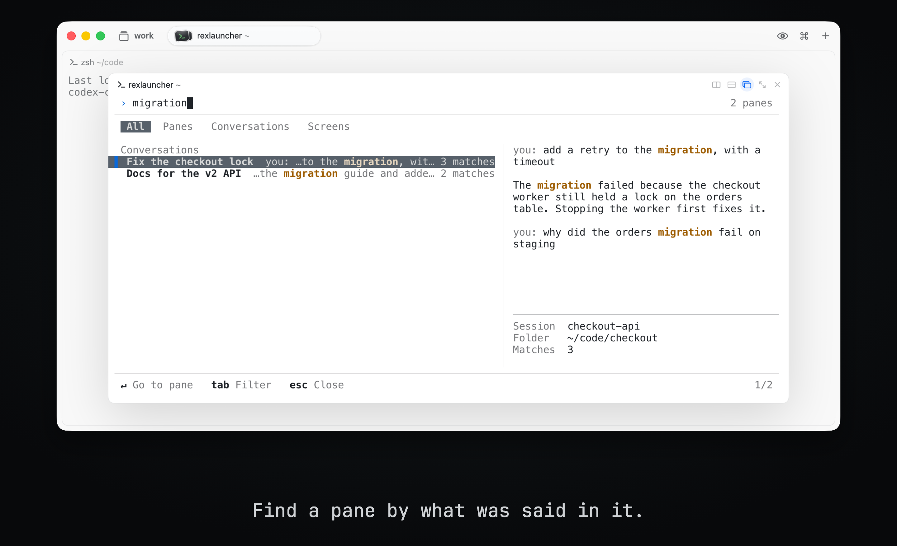

<h1 align="center">Rex Launcher</h1>

<h3 align="center">Find any Rex pane by what was said in it.</h3>

<p align="center">
  
</p>

Rex Launcher is a [rexd](https://github.com/tornikegomareli/rexd) plugin for [Rex](https://www.superlogical.com/rex). It searches every pane on your server, and the words said in the Claude Code conversations inside them, then goes to the pane you choose.

Type part of a name, or a word you remember from a conversation.

## Install

```sh
rexd install tornikegomareli/rexlauncher
```

If rexd is new to you, run `rexd setup` first.

To remove it, run `rexd remove tornikegomareli.rexlauncher`.

It needs:

- [rexd](https://github.com/tornikegomareli/rexd) and Go, to build the plugin.
- Remote Control, in Rex's Settings under Rex Server. Rex only lets a program outside the app change the session it shows when this is on. Without it, Enter still focuses the pane in its session, and shows Rex's error.

## Keys

The plugin binds `ctrl+alt+shift+l`. To use another key, bind `rexlauncher` in your `init.lua`:

```lua
rex.bind("cmd+shift+k", "rexlauncher")
```

Rex warns about a key bound to an action it does not have, so if you may remove the plugin, fall back to another action:

```lua
local has_launcher = rexd and rexd.plugins["tornikegomareli.rexlauncher"]
rex.bind("cmd+shift+k", has_launcher and "rexlauncher" or "session.switch")
```

| Action | Key |
| --- | --- |
| Search | Type |
| Move in the list | Up, Down, Ctrl+P, Ctrl+N |
| Move by a page, or to the first or last row | PageUp, PageDown, Home, End |
| Go to the selected pane | Enter, or click the selected row |
| Filter: All, Panes, Conversations, Screens | Tab, Shift+Tab |
| Scroll the matches in the preview | Shift+Up, Shift+Down, or the wheel |
| Delete a word, or the whole query | Ctrl+W, Ctrl+U |
| Close | Esc |

The picker has one row for each pane: its name, and the best match in it. With a window of 72 columns or more, the right side has a preview: all the matches of the selected pane, or its live screen with colors if it has no match. The details of the pane are below the preview.

With no query, the picker lists the conversations that changed last, and then the other panes. A pane in the window of the picker stays under Panes and out of the recent ones, because it is behind the picker.

Press the key again to close the picker.

## What it searches

All the words you type must be in the same message or line. Panes come in this order:

| Panes found by | Text | From |
| --- | --- | --- |
| Name | Session, window and pane names, and the folder | Rex |
| Conversation | What you and Claude Code wrote, the newest first | The transcripts in `~/.claude` |
| Screen | The scrollback of the other panes | Rex |

A pane where your words only occur inside other words comes last: `panes` finds "split panes" before "Japanese". A pane name also matches with letters left out: `tlbr` finds `tilebar`.

Tool calls, tool output and thinking are not searched.

Limits:

- It searches only conversations that are running in a pane now.
- The search reads what the panes held when the picker opened. The preview of a screen stays live. To search newer output, open it again.
- Enter goes to the pane. It cannot scroll Claude Code to the message, so the preview shows the message.
- Rex keeps no scrollback for a program on the alternate screen. For other full-screen agents, such as Codex, only the visible screen is searched.

## Your data

Nothing leaves your machine. A transcript is mostly tool output, so the plugin keeps an index with only the text above, in your cache folder (`~/Library/Caches/rexlauncher` on macOS). Only you can read these files. Each one is deleted 30 days after its conversation was last searched, when the picker opens. `rexd remove` does not delete them, so to remove the plugin and its index, also delete that folder. The text of your other panes stays in memory while the picker is open.

## Develop

```sh
git clone https://github.com/tornikegomareli/rexlauncher.git
rexd install ./rexlauncher --link
make test    # unit tests
make e2e     # against a Rex server of its own
```

## License

[MIT License](LICENSE).
