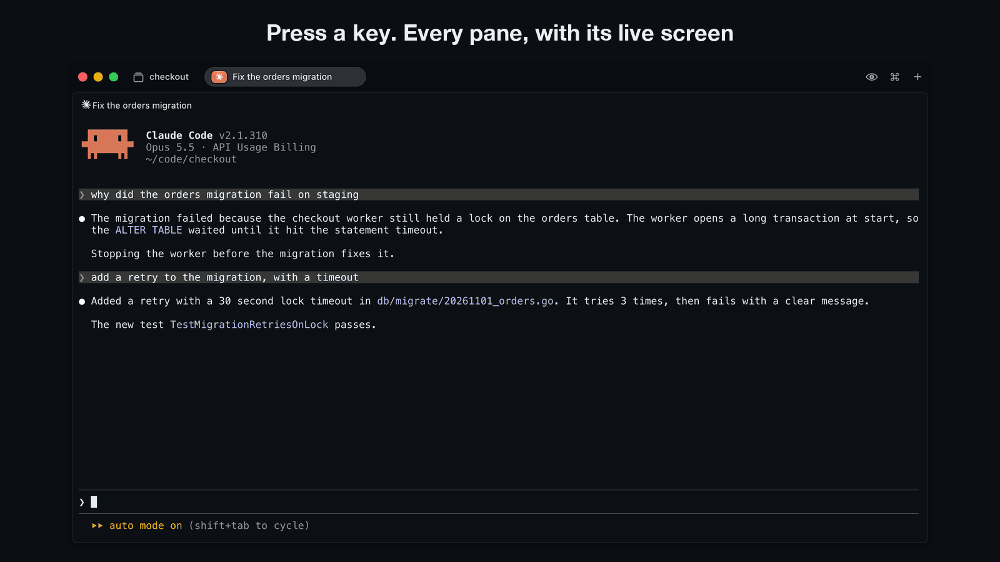
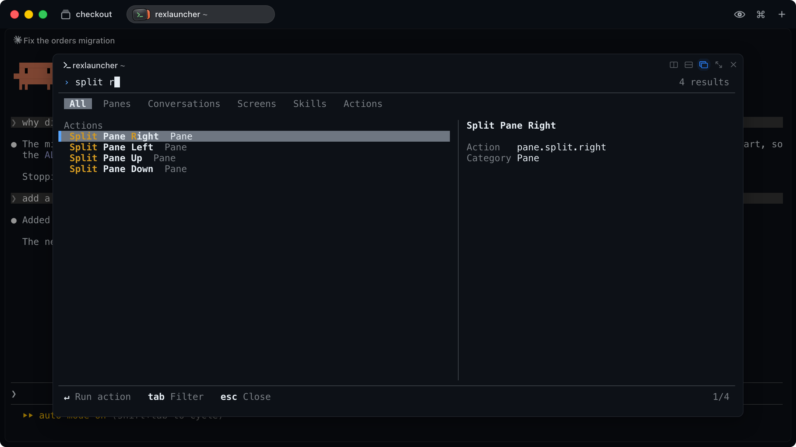
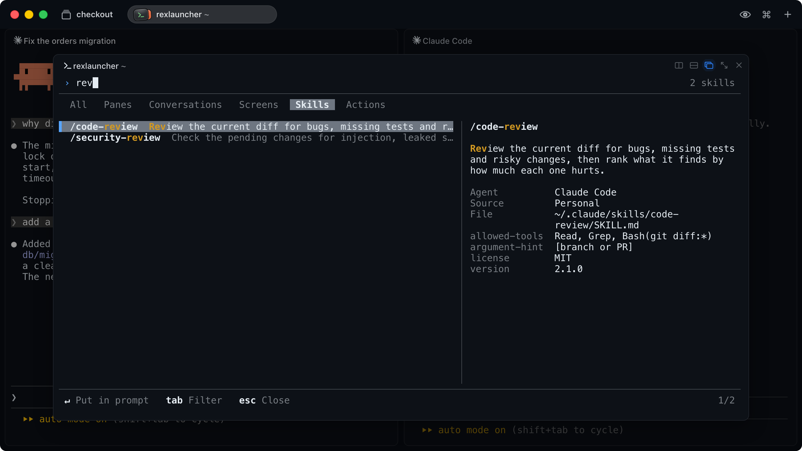

<h1 align="center">Rex Launcher</h1>

<h3 align="center">Find any Rex pane by what was said in it, run any Rex action, and put any skill in your agent's prompt.</h3>

<p align="center">
  
</p>

Rex Launcher is one search box for everything in [Rex](https://www.superlogical.com/rex). Press a key, type a few letters, and press Enter.

| Type | Enter does this |
| --- | --- |
| The name of a session, window, pane or folder | Goes to that pane |
| A word you remember from a Claude Code conversation | Goes to the pane with that conversation, and the preview shows the message |
| A word on any pane's screen, such as an error | Goes to that pane |
| An action, such as `split d`, `theme` or `sidebar` | Runs it on the pane you were on |
| A skill of the agent you were in, such as `review` | Puts `/code-review` in that agent's prompt |

It is a [rexd](https://github.com/tornikegomareli/rexd) plugin.

## Install

```sh
rexd install tornikegomareli/rexlauncher
```

If rexd is new to you, run `rexd setup` first.

To remove it, run `rexd remove tornikegomareli.rexlauncher`.

It needs:

- [rexd](https://github.com/tornikegomareli/rexd) and Go, to build the plugin.
- Remote Control, in Rex's Settings under Rex Server. Rex only lets a program outside the app change the session it shows, or perform its actions, when this is on. Without it, Enter on a pane still focuses the pane in its session, and shows Rex's error.

## Keys

The plugin binds `ctrl+alt+shift+l`. To use another key, bind `rexlauncher` in your `init.lua`:

```lua
rex.bind("cmd+shift+k", "rexlauncher")
```

Rex warns about a key bound to an action it does not have, so if you may remove the plugin, fall back to another action:

```lua
local has_launcher = rexd and rexd.plugins["tornikegomareli.rexlauncher"]
rex.bind("cmd+shift+k", has_launcher and "rexlauncher" or "session.switch")
```

| Action | Key |
| --- | --- |
| Search | Type |
| Move in the list | Up, Down, Ctrl+P, Ctrl+N |
| Move by a page, or to the first or last row | PageUp, PageDown, Home, End |
| Go to the selected pane, run the selected action, or put the selected skill in the prompt | Enter, or click the selected row |
| Filter: All, Panes, Conversations, Screens, Skills, Actions | Tab, Shift+Tab |
| Scroll the preview | Shift+Up, Shift+Down, or the wheel |
| Delete a word, or the whole query | Ctrl+W, Ctrl+U |
| Close | Esc |

The picker has one row for each pane: its name, and the best match in it. With a window of 72 columns or more, the right side has a preview: all the matches of the selected pane, or its live screen with colors if it has no match. The details of the pane are below the preview.

With no query, the picker lists the conversations that changed last, and then the other panes. A pane in the window of the picker stays under Panes and out of the recent ones, because it is behind the picker.

Press the key again to close the picker.

## Actions

<p align="center">
  
</p>

You can run Rex's actions without leaving the search box. It has the actions in Rex's palette and those of your `init.lua`:

- Split a pane down, right, left or up.
- Zoom, float or move a pane, and balance the splits.
- Open the theme picker, and toggle the sidebar.
- Start a new tab, window or session.
- Run your own actions, such as a `lazygit` one.

An action runs on the pane you were on when you opened the picker.

With a query, the All tab shows up to 4 actions, below the panes with that name and above the conversations. The Actions tab lists all of them.

It leaves out actions that close or restart something, such as Close Pane, because Enter runs the first row, and a word you type to find a conversation can match their titles. It also leaves out actions that need an argument. Rex's palette has both.

## Skills

<p align="center">
  
</p>

Open the picker from a pane that runs an agent, and the Skills tab lists what that agent can run. The preview shows what the selected skill does, where it comes from, and the rest of its frontmatter.

Enter puts the name in the prompt of the pane you were on, with a space after it, and sends nothing. You can add arguments, and you press Enter yourself. The text goes where the prompt's cursor is, so a draft stays.

| Agent | Enter puts | Where the list comes from |
| --- | --- | --- |
| Claude Code | `/name`, or `/plugin:name` | Your skills and commands in `~/.claude`, those of the project, and the plugins that are on |
| Codex | `$name` | Codex, through `codex app-server`. Skills that are off stay out |
| pi | `/skill:name` | pi, through `pi --mode rpc`, without its extensions |

For Codex and pi, the plugin starts a second copy for a moment to ask. It does not affect the agent in your pane.

With a query, the All tab shows up to 4 skills, below the panes with that name. The Skills tab lists all of them. A pane with no agent has no skills, and the tab says so.

Claude Code has no command that lists its skills, so the plugin reads the same folders. It leaves out skills from your claude.ai account, enterprise skills, and Claude Code's own commands, such as `/clear`.

## What it searches

All the words you type must be in the same message or line. Panes come in this order:

| Panes found by | Text | From |
| --- | --- | --- |
| Name | Session, window and pane names, and the folder | Rex |
| Conversation | What you and Claude Code wrote, the newest first | The transcripts in `~/.claude` |
| Screen | The scrollback of the other panes | Rex |

A pane where your words only occur inside other words comes last: `panes` finds "split panes" before "Japanese". A pane name also matches with letters left out: `tlbr` finds `tilebar`.

Tool calls, tool output and thinking are not searched.

Limits:

- It searches only conversations that are running in a pane now.
- The search reads what the panes held when the picker opened. The preview of a screen stays live. To search newer output, open it again.
- Enter goes to the pane. It cannot scroll Claude Code to the message, so the preview shows the message.
- Rex keeps no scrollback for a program on the alternate screen. For other full-screen agents, such as Codex, only the visible screen is searched.

## Your data

Nothing leaves your machine. A transcript is mostly tool output, so the plugin keeps an index with only the text above, in your cache folder (`~/Library/Caches/rexlauncher` on macOS). Only you can read these files. Each one is deleted 30 days after its conversation was last searched, when the picker opens. `rexd remove` does not delete them, so to remove the plugin and its index, also delete that folder. The text of your other panes stays in memory while the picker is open.

## Develop

```sh
git clone https://github.com/tornikegomareli/rexlauncher.git
rexd install ./rexlauncher --link
make test    # unit tests
make e2e     # against a Rex server of its own
```

| Folder | What it holds |
| --- | --- |
| `cmd/rexlauncher` | The program |
| `internal/picker` | The screen: the query, the rows and the preview |
| `internal/search` | What finds panes and actions, and their order |
| `internal/rex` | Everything it asks the `rex` command |
| `internal/conversations` | Everything it knows about Claude Code's conversations |
| `internal/skills` | What finds the skills of Claude Code, Codex and pi |
| `rex/config.lua` | The action and the key, loaded into Rex's config |
| `e2e` | Tests against a real Rex |

## License

[MIT License](LICENSE).
